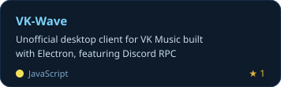
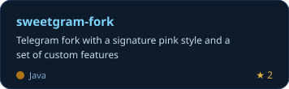
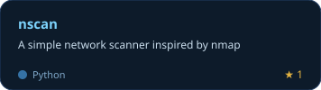
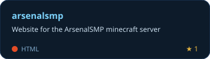
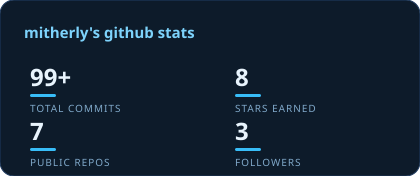
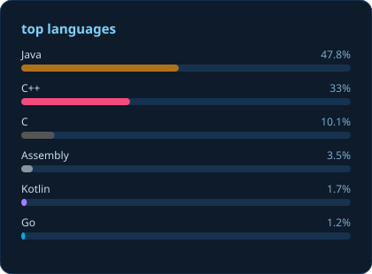

# hey, i'm **mitherly** 👋

**aka `tyro`** · 15 y/o · Russia 🇷🇺

---

## ⚡ about me

- 🎂 **15 y/o, self-taught** — started with python and never stopped
- 🐍 **mid** in `python` · `javascript` · `typescript` — **junior** in `java`, climbing ☕
- 🛡 into **cybersecurity** — wrote [nscan](https://github.com/mitherly/nscan), a network scanner inspired by nmap
- 🔀 **open-source enjoyer** — forking projects i love and making them mine (hi, [sweetgram](https://github.com/mitherly/sweetgram-fork))
- 🌱 currently learning **spring boot** & java backend
- 💬 ask me about python, flask or electron — i'll talk your ear off

---

## 🧰 tech stack

### languages

### backend & desktop

### learning

### tools

---

## 🤖 ai-assisted dev

> i ship faster with ai in the loop — from scaffolding to the final PR

---

## 🚀 projects

<table>
  <tr>
    <td width="50%">
      
    </td>
    <td width="50%">
      
    </td>
  </tr>
  <tr>
    <td width="50%">
      
    </td>
    <td width="50%">
      
    </td>
  </tr>
</table>

🔧 also on my profile: [itgram](https://github.com/mitherly/itgram) · [pyfable](https://github.com/mitherly/pyfable)

---

## 📊 github stats

<table>
  <tr>
    <td width="50%"></td>
    <td width="50%"></td>
  </tr>
</table>

  

---

## 📫 reach me

`discord: tyro.foidslayer` — copy, don't type 😅

---

  

